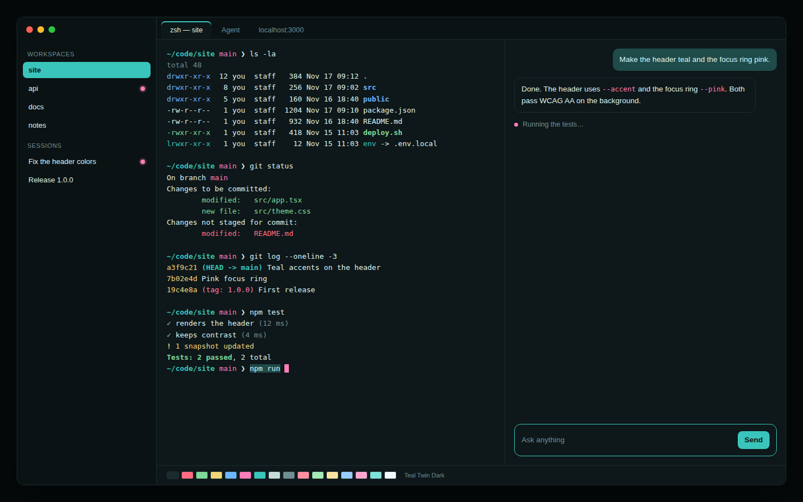
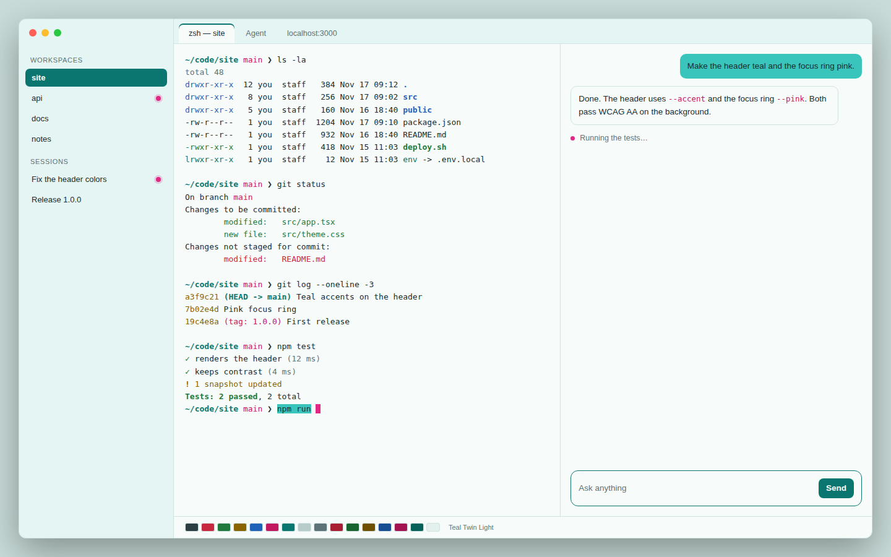

# Teal Twin

[](https://cmux.com/extensions/teamleaderleo/teal-twin-theme)

A cmux theme in teal and pink. Teal `#39C5BB` is the main color, pink the accent, in a dark and a
light look. Colors only: no code runs.





The pictures are previews drawn from the theme's colors.

- **Teal Twin Dark** (`themes/teal-twin-dark.json`): teal on a deep teal-black, pink cursor and
  agent marks. Picked on install.
- **Teal Twin Light** (`themes/teal-twin-light.json`): teal and pink on a pale mint-white.
  `cmux theme use teal-twin-light` picks it.

## Install

```sh
cmux theme install github.com/teamleaderleo/teal-twin-theme
```

cmux shows one line (what it is, where it comes from, that no code runs) and asks first.
`cmux theme update` follows new releases; `cmux theme remove teamleaderleo/teal-twin-theme` puts back
the look you had.

## Colors and contrast

Every text color is checked against WCAG 2.1 AA: 4.5:1 or more for text on its background.

### Dark (background `#0E1719`)

| Use | Color | Contrast |
| --- | --- | --- |
| Text | `#DDF3F0` | 15.7:1 |
| Accent (teal) | `#39C5BB` | 8.6:1 |
| Pink (cursor, agent marks, magenta) | `#FF7EB9` | 7.7:1 |
| Text on a selection (`#1F4B4A`) | `#DDF3F0` | 8.4:1 |
| Text on the accent (buttons) | `#0E1719` on `#39C5BB` | 8.6:1 |
| Sidebar (`#0A1214`) text / teal / pink | | 16.4 / 8.9 / 8.1:1 |
| Palette 1 to 7 | `#FF6B81` `#7FD99A` `#F2D479` `#6CB6FF` `#FF7EB9` `#39C5BB` `#C6DCD9` | 6.6 to 12.7:1 |
| Palette 8 to 15 | `#6F8E92` `#FF8FA0` `#A3EBB6` `#F8E3A0` `#99CCFF` `#FFA6CF` `#7DE3DA` `#F2FBFA` | 5.2 to 17.3:1 |

Palette 0 (`#1B2A2D`, black) is a background color, 1.2:1 by design.

### Light (background `#F7FCFB`)

| Use | Color | Contrast |
| --- | --- | --- |
| Text | `#1A2E31` | 13.7:1 |
| Accent (deep teal) | `#0A766F` | 5.3:1 |
| Pink text (magenta) | `#C2185F` | 5.7:1 |
| Pink cursor and agent marks | `#E12885` | 4.2:1 (non-text: 3:1 needed) |
| Selection, teal `#39C5BB`, with text | `#1A2E31` on `#39C5BB` | 6.7:1 |
| Text on the accent (buttons) | `#FFFFFF` on `#0A766F` | 5.5:1 |
| Sidebar (`#E4F5F3`) text / accent | | 12.6 / 4.9:1 |
| Palette 0 to 6 | `#2C3E41` `#C8283F` `#1F7A3D` `#8A6400` `#1F63B8` `#C2185F` `#0A766F` | 5.2 to 10.8:1 |
| Palette 8 to 14 | `#5E7377` `#A81F33` `#18642F` `#6E5000` `#174E93` `#A3134F` `#086158` | 4.8 to 8.0:1 |

On white, teal `#39C5BB` is 2.1:1, too light for text, so the light look uses it as the selection
and a deeper teal for the accent. Palette 7 and 15 (`#B8CCC9`, `#E4F0EE`, white) are background
colors, 1.6:1 and 1.1:1 by design.

## Make your own

1. `cmux theme export --save my-look` writes your current look as `themes/my-look.json`.
2. Put it in a repo under `themes/`, with a `cmux-theme.json` at the root like this one (`id` starts
   with your GitHub name).
3. `cmux theme check themes/my-look.json` reports anything cmux would not load.
4. Tag a release with the version (`1.0.0`), and open a PR adding it to `themes.json` in
   [manaflow-ai/cmux-extensions](https://github.com/manaflow-ai/cmux-extensions) to list it on cmux.com.

## License

MIT
