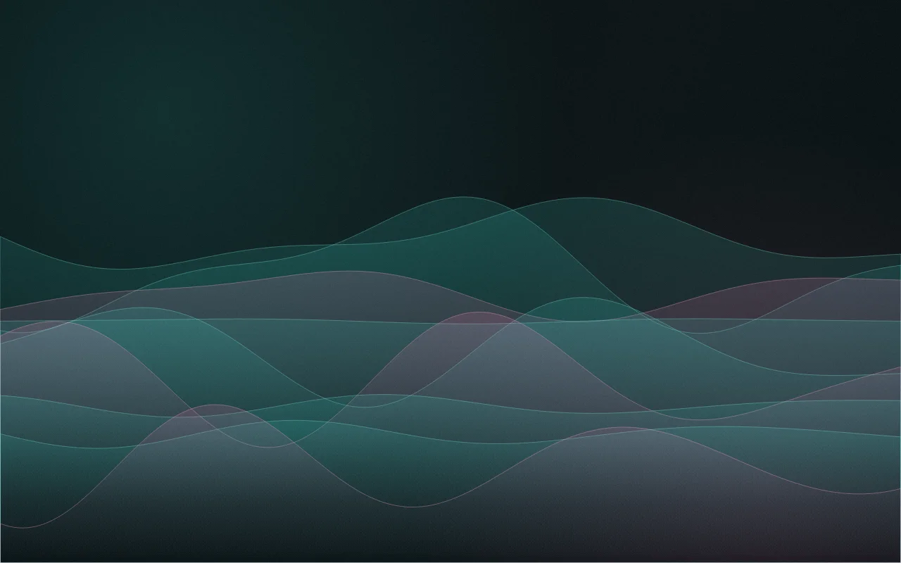
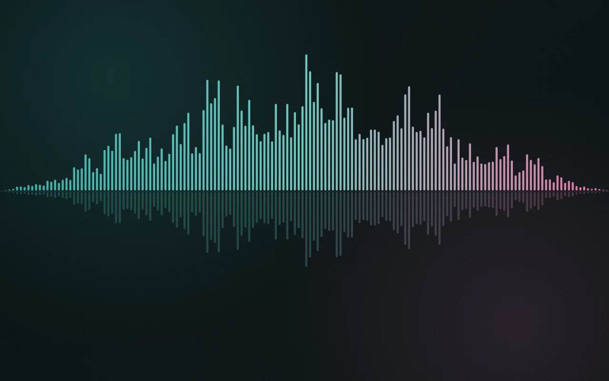
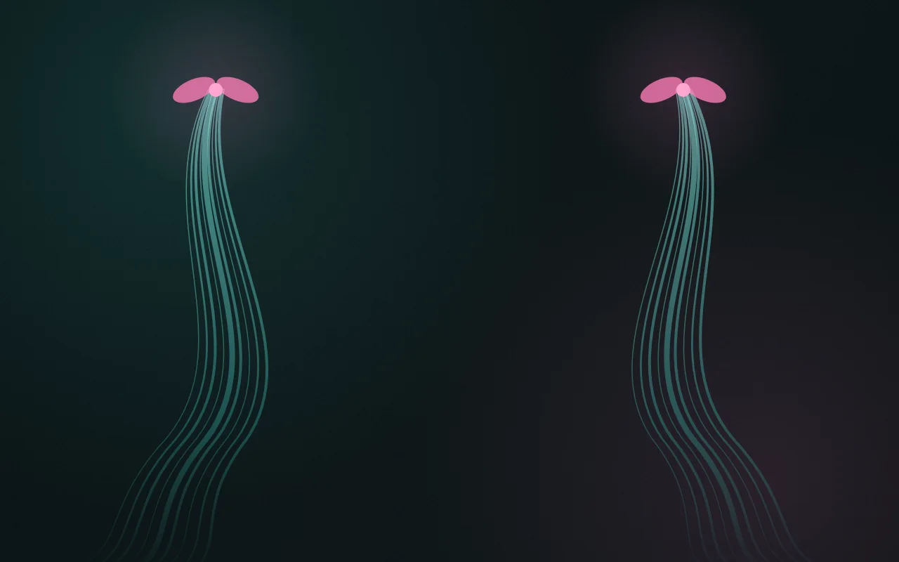
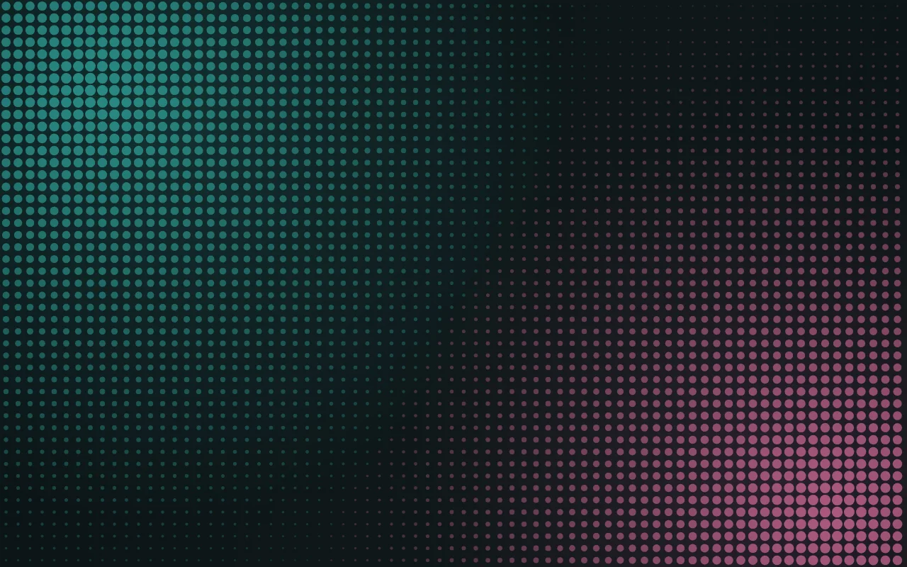
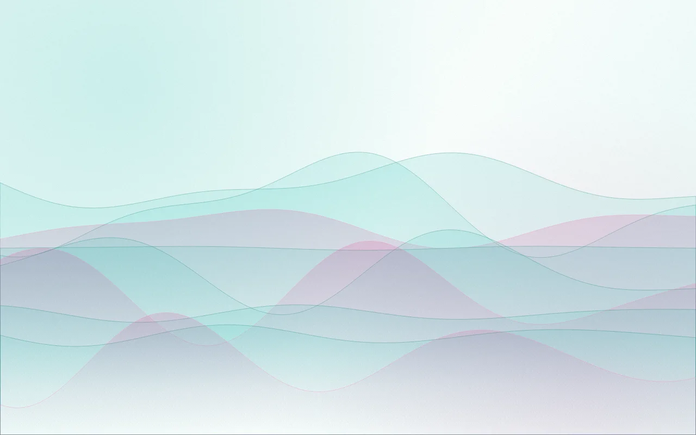
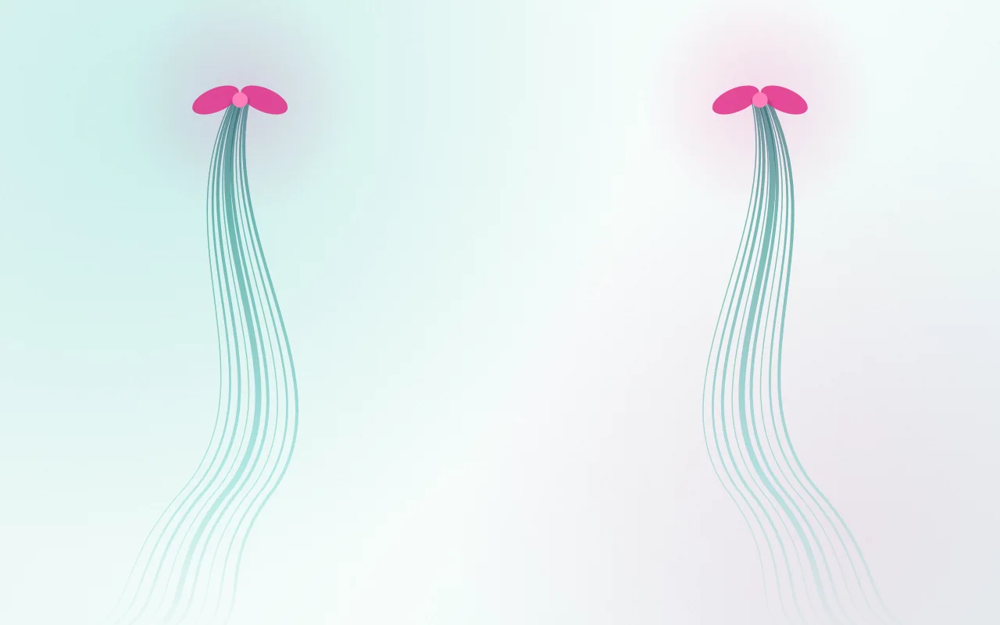
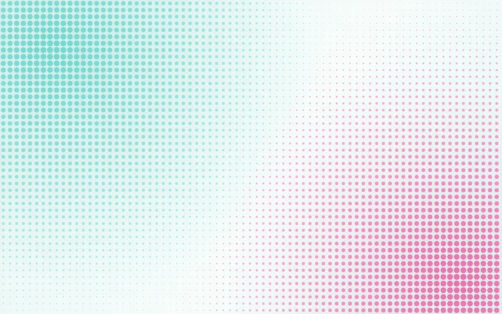
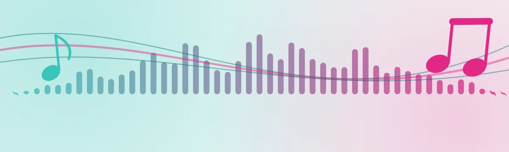

# Teal Twin

[](https://cmux.com/extensions/teamleaderleo/teal-twin-theme)

A cmux theme in teal and pink. Teal `#39C5BB` is the main color and pink the accent, in a dark
look and a light look, with ten wallpapers (five dark, five light) that change every hour, a
sidebar header, and a few flourishes. No code runs.


The window pictures are previews drawn from the theme's colors and wallpapers.

- **Teal Twin Dark** (`themes/teal-twin-dark.json`): teal on a deep teal-black, a pink cursor and
  agent marks, over the dark wallpapers. Picked on install.
- **Teal Twin Light** (`themes/teal-twin-light.json`): teal and pink on a pale mint-white, over
  the light wallpapers. `cmux theme use teal-twin-light` picks it.

## Install

```sh
cmux theme install github.com/teamleaderleo/teal-twin-theme
```

cmux shows one line (what it is, where it comes from, that no code runs) and asks first.
`cmux theme update` follows new releases; `cmux theme remove teamleaderleo/teal-twin-theme` puts back
the look you had.

## Wallpapers

Original abstract art in teal and pink: waves, a sound wave, musical notes, twin ribbons and a
halftone grid. Each is 2560x1600 (`wallpapers/dark/`, `wallpapers/light/`), with a 1280x800 copy
for pane backgrounds (`wallpapers/pane/`). The theme shows them in turn, one an hour.

| | Waves | Sound wave | Notes | Ribbons | Halftone |
| --- | --- | --- | --- | --- | --- |
| Dark |  |  |  |  |  |
| Light |  |  |  |  |  |

Sidebar header (`header/dark.webp`, `header/light.webp`):




To keep one picture, run `cmux wallpaper set` with one of the files above. To change how often
they turn, use `cmux wallpaper rotate`.

**The art is original.** It is drawn by code in this repo (`tools/wallpapers/art.js`, the canvas
2D API) and contains no figures, characters or logos. It is MIT licensed like the rest of the
repo. `tools/wallpapers/render.sh` redraws any of them byte for byte with headless Chrome.

Gradients between two colors (teal to pink in the sound wave and the header, deep to light teal in
the ribbons) are mixed in Oklab, as CSS `color-mix(in oklab, ...)` does, with a stop every tenth of
the way. Mixed in plain sRGB, teal to pink sags into a darker gray-violet halfway; in Oklab its
lightness runs evenly from one end to the other.

## Flourishes

- The accent: selection, focus and the Send button take the theme's teal.
- The focused pane gets a teal border.
- While an agent works, a pink dot pulses in its sidebar row and tab.
- Colors ease into place when the theme changes.
- The cursor is pink.
- `cmux-theme.json` also describes a soft teal accent glow, a blinking bar cursor, and teal to pink
  (mixed in Oklab) for the tab-close animation. They apply where your cmux supports them.

## Colors and contrast

Every text color is checked against WCAG 2.1 AA, which asks for 4.5:1 or more for text on its
background. Terminals are 88% opaque over the wallpapers, so each text color is also checked over the
brightest wallpaper pixel showing through.

### Dark (background `#0E1719`)

| Use | Color | Contrast | Over the brightest wallpaper pixel |
| --- | --- | --- | --- |
| Text | `#DDF3F0` | 15.7:1 | 12.1:1 |
| Accent (teal) | `#39C5BB` | 8.6:1 | |
| Pink (cursor, agent marks, magenta) | `#FF7EB9` | 7.7:1 | |
| Text on a selection (`#1F4B4A`) | `#DDF3F0` | 8.4:1 | |
| Text on the accent (buttons) | `#0E1719` on `#39C5BB` | 8.6:1 | |
| Sidebar (`#0A1214`) text / teal / pink | | 16.4 / 8.9 / 8.1:1 | |
| Palette 1 to 15 (all but black) | `#FF6B81` `#7FD99A` `#F2D479` `#6CB6FF` `#FF7EB9` `#39C5BB` `#C6DCD9` `#86A5A9` `#FF8FA0` `#A3EBB6` `#F8E3A0` `#99CCFF` `#FFA6CF` `#7DE3DA` `#F2FBFA` | 6.6 to 17.3:1 | 5.1:1 or more |

Palette 0 (`#1B2A2D`, black) is a background color, 1.2:1 by design.

### Light (background `#F7FCFB`)

| Use | Color | Contrast | Over the strongest wallpaper pixel |
| --- | --- | --- | --- |
| Text | `#1A2E31` | 13.7:1 | 11.5:1 |
| Accent (deep teal) | `#0A766F` | 5.3:1 | |
| Pink text (magenta) | `#C2185F` | 5.7:1 | 4.7:1 |
| Pink cursor and agent marks | `#E12885` | 4.2:1 (not text: 3:1 needed) | |
| Selection, teal `#39C5BB`, with text | `#1A2E31` on `#39C5BB` | 6.7:1 | |
| Text on the accent (buttons) | `#FFFFFF` on `#0A766F` | 5.5:1 | |
| Sidebar (`#E4F5F3`) text / accent | | 12.6 / 4.9:1 | |
| Palette 0 to 6 | `#2C3E41` `#B8243A` `#186F38` `#7E5B00` `#1F63B8` `#C2185F` `#086A63` | 5.7 to 10.8:1 | 4.7:1 or more |
| Palette 8 to 14 | `#4D6064` `#A81F33` `#18642F` `#6E5000` `#174E93` `#A3134F` `#086158` | 6.4 to 8.0:1 | 5.1:1 or more |

On white, teal `#39C5BB` is 2.1:1, too light for text, so the light look uses it as the selection
and a deeper teal for the accent. Palette 7 and 15 (`#B8CCC9`, `#E4F0EE`, white) are background
colors, 1.6:1 and 1.1:1 by design.

## Make your own

1. `cmux theme export --save my-look` writes your current look as `themes/my-look.json`.
2. Put it in a repo under `themes/`, with a `cmux-theme.json` at the root like this one (`id` starts
   with your GitHub name).
3. `cmux theme check themes/my-look.json` reports anything cmux would not load.
4. Tag a release with the version (`1.0.0`), and open a PR adding it to `themes.json` in
   [manaflow-ai/cmux-extensions](https://github.com/manaflow-ai/cmux-extensions) to list it on cmux.com.

## License

MIT, the wallpapers and header included.
